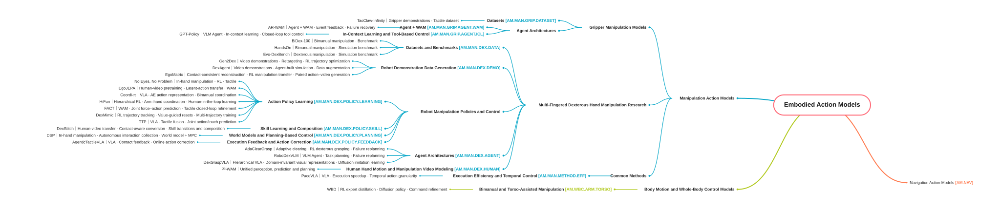

# Embodied Action Model Research Map

Learned models for robot action generation and control, evaluation benchmarks, and reading notes.

[简体中文](README_cn.md) · [Scope and rationale](docs/scope.md) · [Contribution guide](CONTRIBUTING.md)

## Start Here

1. Use the map to understand the research structure; it shows selected representative works.
2. Open a category to read every indexed work and its concise summary.
3. Follow a record's Notes link for detailed reading or reproduction notes when available.

The current focus is **manipulation action models**. Navigation and body motion / whole-body control remain research entry points. Manipulation provides platform entries for grippers and multi-fingered dexterous hands, plus common methods across platforms. Dexterous hands includes Benchmarks and Demonstration Acquisition and Action Conversion → Video Demonstrations to Robot Actions; common methods includes execution efficiency and temporal control.

[](mindmap.svg)

## Category Navigation

<!-- BEGIN GENERATED:CATALOG -->

| Category | Code | Records | Index |
|---|---|---:|---|
| Gripper Manipulation Models | `AM.MAN.GRIP` | 0 | [Open](catalog/manipulation/grippers.md) |
| Benchmarks | `AM.MAN.DEX.BENCH` | 2 | [Open](catalog/manipulation/dexterous/benchmarks.md) |
| Video Demonstrations to Robot Actions | `AM.MAN.DEX.DEMO.V2R` | 1 | [Open](catalog/manipulation/dexterous/demonstrations/video-to-robot.md) |
| Execution Efficiency and Temporal Control | `AM.MAN.METHOD.EFF` | 1 | [Open](catalog/manipulation/common-methods/execution-efficiency.md) |
| Navigation Action Models | `AM.NAV` | 0 | [Open](catalog/navigation.md) |
| Body Motion and Whole-Body Control Models | `AM.WBC` | 0 | [Open](catalog/whole-body-control.md) |

<!-- END GENERATED:CATALOG -->

[Browse all categories](catalog/README.md)

## Where Content Lives

| Location | Purpose |
|---|---|
| [data/papers/](data/papers/) | One JSON per work: stable ID, category, bilingual summary, links, and verification details |
| [catalog/](catalog/README.md) | Generated bilingual indexes containing the complete collection |
| [notes/](notes/README.md) | Optional detailed reading, comparison, and reproduction notes |
| [taxonomy.json](taxonomy.json) | Category hierarchy, bilingual names, and index routes |
| [docs/scope.md](docs/scope.md) | Scope, classification boundaries, and supporting surveys |

## Growing the Collection

Every work needs a concise source-backed record. Benchmark summaries specify hand types, task counts, same-task cross-hand reuse, release status, and the key distinction. Detailed notes are optional. Keep paper claims, published assets, evaluated configurations, and reproduced results distinct; retain explicit unknowns.

After editing source data, run:

```bash
python3 scripts/build_catalog.py
python3 scripts/build_catalog.py --check
python3 -m unittest discover -s tests -v
```

See [CONTRIBUTING.md](CONTRIBUTING.md) for fields, templates, and workflow. Homepages, category pages, and maps are generated from the same records.

## Acknowledgments

Map presentation and category-based indexing were inspired by [Hand3DResearch](https://github.com/SeanChenxy/Hand3DResearch). This repository independently maintains its embodied-action scope and categories.
