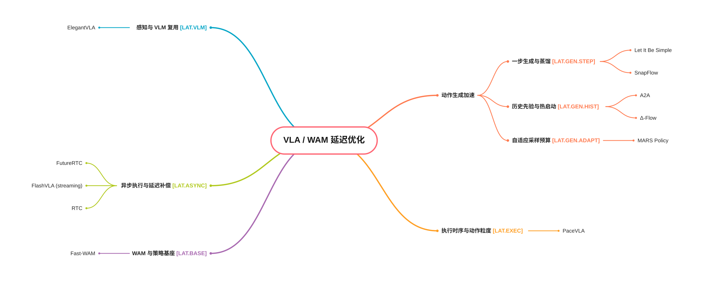

# 具身动作模型研究地图

面向机器人动作生成与控制的学习式模型、评测基准和阅读记录。

[English](README.md) · [研究范围与分类依据](docs/scope_cn.md) · [维护规范](CONTRIBUTING.md)

## 从这里开始

1. 看下方导图了解研究结构；总图仅展示选定代表工作。
2. 点击分类入口，阅读该方向的全部短条目与 TL;DR。
3. 需要深入时，点击条目中的“笔记”查看单篇阅读记录。

当前重点是**操作动作模型**；导航、身体运动与全身控制保留研究入口。操作按夹爪和多指灵巧手组织，灵巧手下已有 Benchmarks 分支。

[](mindmap_cn.svg)

## 分类入口

<!-- BEGIN GENERATED:CATALOG -->

| 分类 | 编号前缀 | 条目数 | 阅读入口 |
|---|---|---:|---|
| 夹爪操作模型 | `AM.MAN.GRIP` | 0 | [查看](catalog/manipulation/grippers_cn.md) |
| Benchmarks｜评测基准 | `AM.MAN.DEX.BENCH` | 2 | [查看](catalog/manipulation/dexterous/benchmarks_cn.md) |
| 导航动作模型 | `AM.NAV` | 0 | [查看](catalog/navigation_cn.md) |
| 身体运动与全身控制模型 | `AM.WBC` | 0 | [查看](catalog/whole-body-control_cn.md) |

<!-- END GENERATED:CATALOG -->

[查看全部分类](catalog/README_cn.md)

## 内容放在哪里

| 位置 | 用途 |
|---|---|
| [data/papers/](data/papers/) | 每篇一个 JSON，统一维护编号、分类、双语摘要、链接和核验信息 |
| [catalog/](catalog/README_cn.md) | 自动生成的双语分类索引，收录全部工作 |
| [notes/](notes/README.md) | 可选的单篇阅读笔记、方法比较与复现记录 |
| [taxonomy.json](taxonomy.json) | 分类层级、双语名称及索引路径 |
| [docs/scope_cn.md](docs/scope_cn.md) | 研究范围、分类边界和参考综述 |

## 后续如何积累

每篇至少有一条带来源的短记录；基准摘要须说明手型、任务数、同任务跨手复用、开放状态和核心特点。详细笔记按需建立。论文声明、公开资产、实际评测配置和自己复现的结果分别记录，未知信息明确保留。

新增或修改数据后运行：

```bash
python3 scripts/build_catalog.py
python3 scripts/build_catalog.py --check
python3 -m unittest discover -s tests -v
```

具体步骤、字段说明和模板见 [CONTRIBUTING.md](CONTRIBUTING.md)。首页、分类页、导图无需逐篇重复录入。

## 致谢

思维导图展示与分类编号组织方式参考 [Hand3DResearch](https://github.com/SeanChenxy/Hand3DResearch)。本仓库独立维护具身动作模型的范围与分类。
